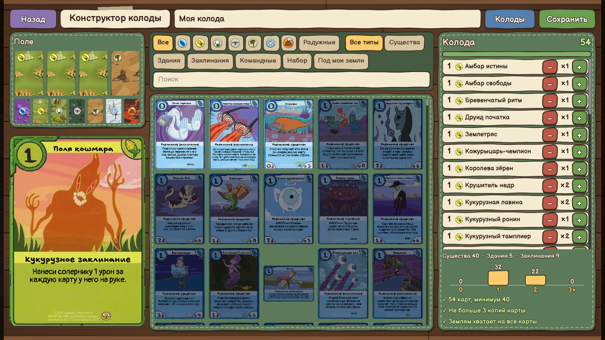

# Карточные войны

Фанатский порт настольной игры Card Wars из мультсериала «Время приключений». Сделан на Godot 4, работает на Windows, Android, macOS, Linux и iOS. Это альфа, так что баги есть и баланс ещё меняется.

## Что есть в игре

- Игра против ИИ, несколько уровней сложности.
- Игра вдвоём на одном устройстве.
- Игра по сети: создаёшь комнату или заходишь в чужую по коду.
- Бесконечный поезд: рогалик, где герой идёт по вагонам через бои, события и лавку, пока не проиграет. Есть сложность, предметы и проклятия.
- Поезд дня: один забег для всех на сутки и таблица результатов.
- Конструктор колод.
- Аккаунты с ником и аватаркой. Играть можно и без аккаунта.




## Скачать

| Система | Файл |
|---|---|
| Windows | [установщик](https://github.com/kiberbus/card-wars/releases/latest/download/CardWars-Windows-Setup.exe), [zip без установки](https://github.com/kiberbus/card-wars/releases/latest/download/CardWars-Windows.zip) |
| Android | [APK](https://github.com/kiberbus/card-wars/releases/latest/download/CardWars-Android.apk) |
| macOS | [dmg](https://github.com/kiberbus/card-wars/releases/latest/download/CardWars-macOS.dmg), [zip](https://github.com/kiberbus/card-wars/releases/latest/download/CardWars-macOS.zip) |
| Linux | [tar.gz](https://github.com/kiberbus/card-wars/releases/latest/download/CardWars-Linux.tar.gz) |
| iOS | [IPA](https://github.com/kiberbus/card-wars/releases/latest/download/CardWars-iOS.ipa) |

Версия везде одна, по сети можно играть с кем угодно. Обновления игра скачивает сама при запуске и перезапускается, переустанавливать ничего не надо. Колоды и прогресс остаются.

### Windows

Запусти `CardWars-Windows-Setup.exe`. Игра появится в «Пуске» и на рабочем столе, права администратора не нужны.

Если не хочешь ставить, распакуй `CardWars-Windows.zip` в любую папку, например на рабочий стол, и запусти `CardWars.exe`.

Если Windows напишет «Windows защитила ваш компьютер», нажми «Подробнее», потом «Выполнить в любом случае». Так бывает, потому что у игры нет платной подписи.

### Android

1. Скачай `CardWars-Android.apk` на телефон.
2. Открой файл и разреши установку из этого источника.
3. Если Play Защита ругается, нажми «Всё равно установить».

### macOS

1. Открой `CardWars-macOS.dmg` и перетащи CardWars в «Программы». Можно и через zip: распаковать и перенести туда же.
2. Подписи Apple у игры нет, поэтому macOS при первом запуске может сказать, что программа повреждена. Открой Терминал и выполни один раз:
   ```
   xattr -cr /Applications/CardWars.app
   ```
   После этого игра запускается как обычно.

### Linux

Распакуй `CardWars-Linux.tar.gz` и запусти `CardWars/CardWars.x86_64`.

### iOS

`CardWars-iOS.ipa` не подписан, его нужно подписать своим Apple ID и поставить через Sideloadly или AltStore. Как это сделать, есть видео в [Telegram-канале](https://t.me/card_wars).

На iOS после обновления игра попросит закрыть её и открыть снова.

## Требования

- Windows 10 или 11 (64 бит), Android 7+, macOS 11+, Linux (64 бит), iOS 14+.
- Видеокарта с OpenGL 3.3.
- 2 ГБ оперативной памяти и 2 ГБ на диске.
- Интернет нужен для сетевой игры, аккаунтов и обновлений. С ИИ можно играть без интернета.

## Известные проблемы

- Некоторые редкие сочетания карт срабатывают не так, как написано на карте.
- Если сервер недоступен, сетевая игра и вход в аккаунт не работают.
- Баланс Бесконечного поезда ещё настраивается, забеги бывают слишком лёгкими или слишком сложными.

## Баги и идеи

Пиши через кнопку «Сообщить об ошибке» в главном меню игры. Новости и обсуждение в Telegram: [t.me/card_wars](https://t.me/card_wars).

## Права

Проект фанатский и некоммерческий, с Cartoon Network и Warner Bros. Discovery не связан. Персонажи, названия и карты «Времени приключений» и Card Wars принадлежат правообладателям.
