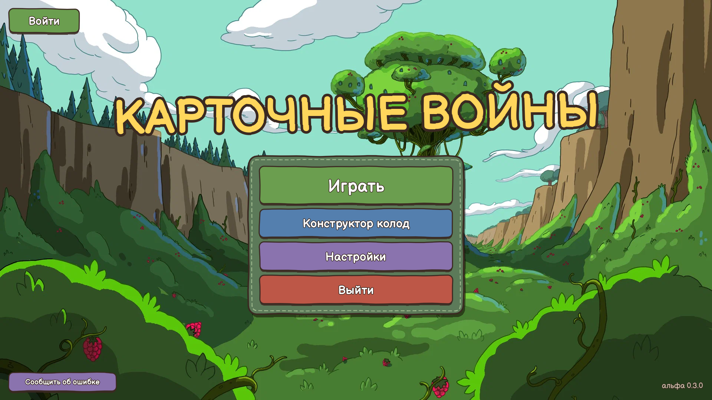
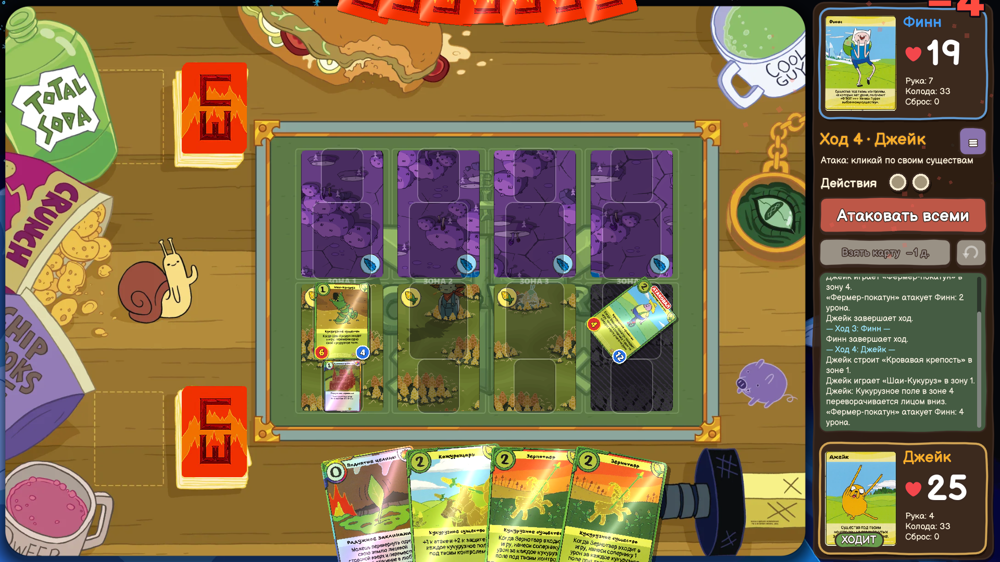
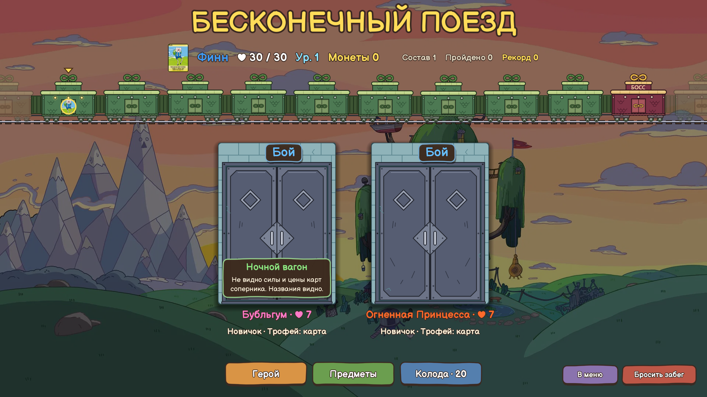

# Карточные войны

Фанатский порт настольной карточной игры **Card Wars** из мультсериала «Время приключений». Игра на Godot 4, для Windows. Сейчас это **альфа**: что-то работает не до конца, баланс ещё правится.

## Что внутри

- **Игра против ИИ** — сражения с компьютерными соперниками разной сложности.
- **Игра на одном ПК** — два игрока за одним компьютером.
- **Игра по сети** — комнаты: создай свою или зайди в чужую, играйте с друзьями.
- **Бесконечный поезд** — рогалик: герой едет в поезде через бои, двери, события и лавку, пока не выбыл. Есть сложность, проклятия и предметы.
- **Поезд дня** — один и тот же забег для всех на сутки, с таблицей результатов.
- **Конструктор колод** — собирай свои колоды.
- **Аккаунты** — ник, пароль и аватарка. Можно играть и без аккаунта.

## Установка

1. Открой [страницу последнего релиза](https://github.com/kiberbus/card-wars/releases/latest) и скачай `CardWars.zip`.
2. Распакуй архив в любую папку.
3. Запусти `CardWars.exe`.

Игра обновляется сама: когда выходит новая версия, при запуске появится окно «Новая версия» с кнопкой «Обновить».

### Предупреждение Windows SmartScreen

При первом запуске Windows может написать «Windows защитила ваш компьютер». Игра не подписана цифровой подписью, поэтому так бывает. Чтобы запустить:

1. Нажми **«Подробнее»**.
2. Нажми **«Выполнить в любом случае»**.

Некоторые антивирусы тоже могут ругаться на неподписанный `exe`. Обычно это ложное срабатывание из-за отсутствия подписи.

## Системные требования

- Windows 10 или 11, 64-бит.
- Видеокарта с поддержкой OpenGL 3.3.
- Оперативная память: 2 ГБ, сама игра занимает около 400 МБ.
- Место на диске: 300 МБ.
- Интернет нужен только для сетевой игры, аккаунтов и обновлений. Игра против ИИ работает и без сети.

## Известные проблемы (альфа)

- Редкие сочетания карт и эффектов могут сработать не так, как написано на карте.
- Сетевая игра и вход в аккаунт зависят от доступности сервера: если он недоступен, игра покажет ошибку подключения.
- Баланс «Бесконечного поезда» ещё настраивается, поэтому некоторые забеги могут выходить слишком лёгкими или тяжёлыми.

## Ошибки и предложения

Нашёл баг или есть идея — нажми кнопку **«Сообщить об ошибке»** в игре (в меню). Новости и обсуждение — в Telegram: [t.me/card_wars](https://t.me/card_wars).

## Дисклеймер

Это фанатский некоммерческий проект. Он не связан с Cartoon Network и Warner Bros. Discovery. Персонажи, названия и карты «Время приключений» и Card Wars принадлежат их правообладателям.
